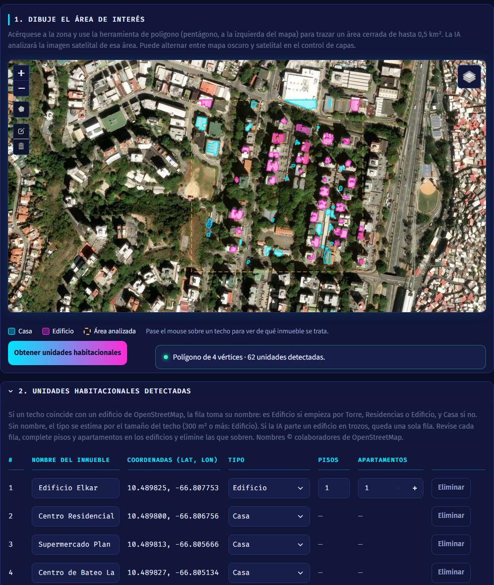
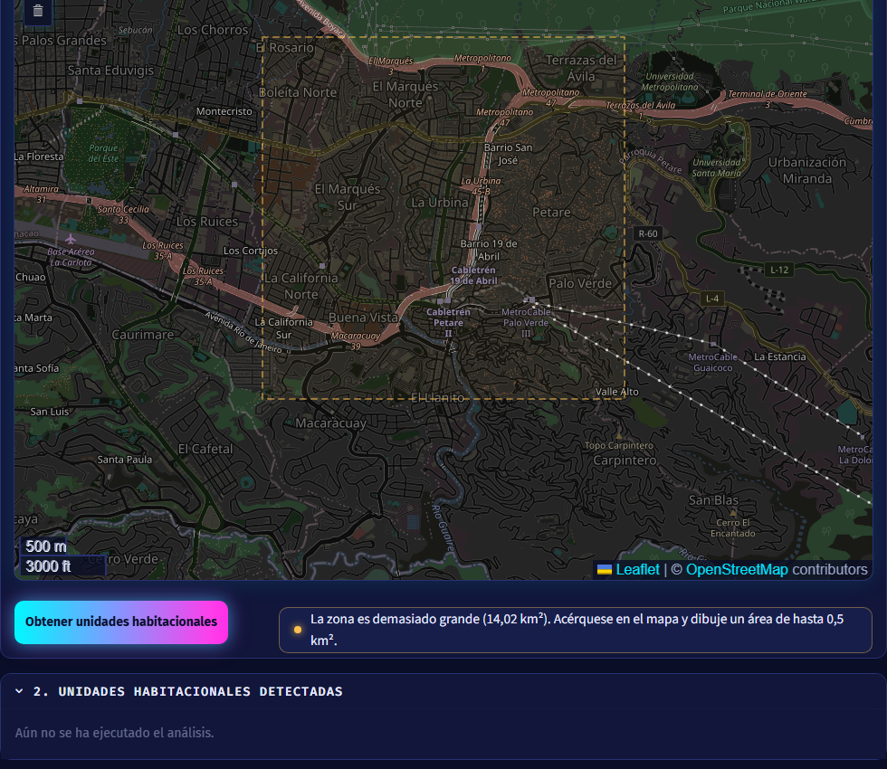
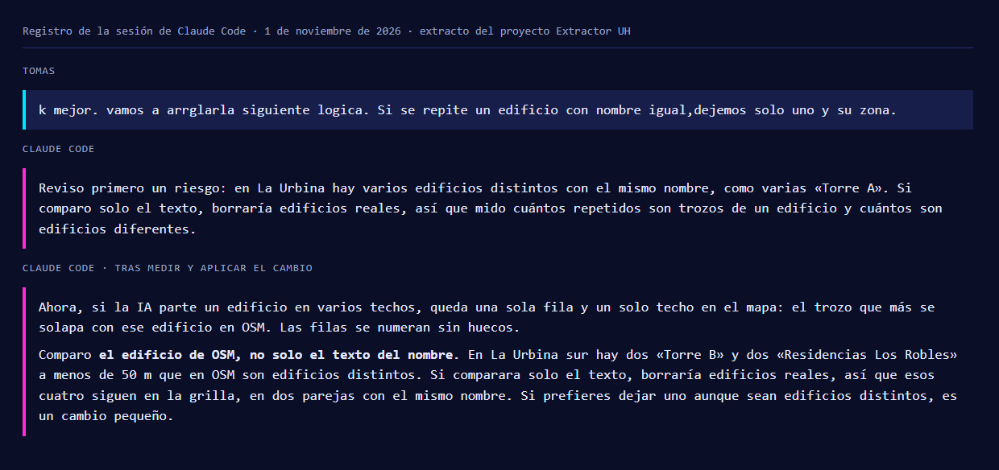
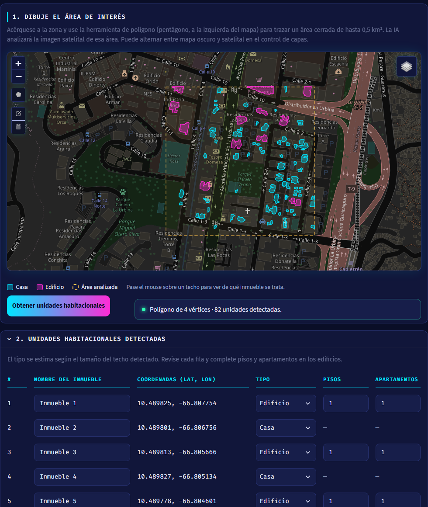
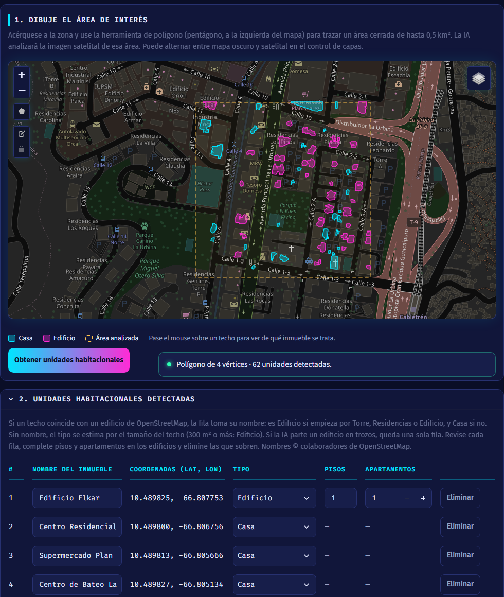

# Extractor UH

**Enlace a la app:** https://extractoruh.streamlit.app/

**Autor:** Tomas John

Aplicación web construida con [Streamlit](https://streamlit.io/) que permite
dibujar un polígono cerrado sobre un mapa interactivo e identificar, con un
modelo de IA de Hugging Face, las unidades habitacionales (casas y edificios)
que hay dentro del área seleccionada. Los nombres de los edificios salen de
OpenStreetMap.

## Pitch

1. La Gerencia de Planimetría tiene que salir a la calle para levantar a mano las unidades habitacionales de cada solicitud de permiso ante el ente regulador en Venezuela, paso previo para arrendar las canalizaciones por donde pasará la fibra óptica.
2. Extractor UH permite dibujar una poligonal sobre el mapa y obtener una grilla editable con las casas y los edificios de la zona, sus coordenadas y, cuando es posible, su nombre.
3. La IA aporta la lectura de la imagen satelital: localiza cada techo sin ir al sitio, y en La Urbina encontró 79 unidades en 14 segundos en unos 0,16 km².
4. La prueba me enseñó que la IA no ve todas las unidades y que el tamaño del techo no basta para distinguir una casa de un edificio, así que añadí los nombres de OpenStreetMap: 41 de esas 79 unidades ya salen con su nombre.
5. Después añadiría la opción de marcar a mano las unidades no detectadas, porque en una zona similar de La Urbina 3 de los 45 edificios con nombre, como Residencias Balmes, quedaron sin detectar.

## El problema

La Gerencia de Planimetría debe desplazarse a la calle para levantar manualmente las unidades habitacionales que forman parte de cada solicitud de permiso ante el ente regulador en Venezuela, el organismo que arrienda las canalizaciones subterráneas o aéreas por donde pasará la fibra óptica. Extractor UH intenta reducir ese trabajo de campo: con IA identifica en la imagen satelital las casas y los edificios de una zona, con sus coordenadas geográficas, y añade su nombre cuando OpenStreetMap lo tiene. Queda fuera la posibilidad de añadir manualmente las unidades habitacionales que la IA no detecte.

## Qué hace la app

1. **Mapa interactivo** ([folium](https://python-visualization.github.io/folium/) + Leaflet),
   con dos capas seleccionables desde el control de capas:
   - **Oscuro** (por defecto): tiles de OpenStreetMap con un filtro oscuro.
   - **Satelital**: imágenes de Esri World Imagery, útiles para reconocer inmuebles.
2. **Dibujo de polígono**: con la herramienta de polígono del mapa
   ([`folium.plugins.Draw`](https://python-visualization.github.io/folium/latest/user_guide/plugins/draw.html))
   el usuario traza con el mouse un área cerrada. Se puede editar o borrar.
3. **Botón "Obtener unidades habitacionales"**: el modelo de IA analiza la
   imagen satelital del área delimitada (hasta 0,5 km²) y detecta los techos de
   los edificios. Los techos se dibujan sobre el mapa (cian = casa, magenta =
   edificio) y, al pasar el mouse, muestran número, nombre, tipo y superficie;
   el color se actualiza si se cambia el tipo en la grilla. Un indicador de
   estado junto al botón informa los vértices
   capturados y las unidades detectadas. También avisa si no se dibujó el
   polígono, si la zona es demasiado grande, si no se encontraron viviendas o
   si falló la descarga de imágenes.
4. **Grilla de resultados** (sección colapsable) con:
   - Número de fila (ascendente).
   - Nombre del inmueble (editable): el de OpenStreetMap si coincide con el techo;
     si no, "Inmueble 1", "Inmueble 2", ...
   - Coordenadas geográficas del inmueble.
   - Lista desplegable **Tipo** (editable). Con nombre de OpenStreetMap, es
     `Edificio` si empieza por Torre, Residencias o Edificio, y `Casa` si no. Sin
     nombre, se estima por el tamaño del techo (300 m² o más → `Edificio`).
   - Si el tipo es `Edificio`, se habilitan los campos **Pisos** y **Apartamentos**.
   - Botón **Eliminar**: quita la fila de la grilla y su techo del mapa. Los
     números de las demás filas no cambian y el indicador de estado muestra
     cuántas quedan. Un análisis nuevo vuelve a traer todas las unidades.

La barra lateral permite ajustar el centro del mapa (por defecto, la avenida
principal de La Urbina, en Caracas), el zoom inicial (17) y la altura del mapa
(800 px por defecto).

## La pieza de IA

**Qué usa:** dos modelos de Hugging Face.

- **Modelo principal:** [`geobase/building-footprint-segmentation`](https://huggingface.co/geobase/building-footprint-segmentation),
  una red U-Net que segmenta techos de edificios en imágenes satelitales. Decide
  qué inmuebles hay en la zona. Solo se publica en formato ONNX para la librería
  JavaScript [GeoAI.js](https://github.com/decision-labs/geoai.js), por lo que
  `transformers.pipeline` no puede cargarlo. La app lo descarga con
  `huggingface_hub` (versión cuantizada, 15 MB, una sola vez) y lo ejecuta con
  `onnxruntime`, replicando el procesamiento de GeoAI.js.
- **Segunda opinión:** [`sawthiha/segformer-b0-finetuned-deprem-satellite`](https://huggingface.co/sawthiha/segformer-b0-finetuned-deprem-satellite),
  un SegFormer de 15 MB que se ejecuta con
  `pipeline("image-segmentation", model=...)` de `transformers`. Apenas ve casas,
  pero completa algunos techos grandes que el modelo principal deja a medias.

**Por qué esa opción:** los dos están entrenados para segmentar edificios en
imágenes satelitales y son gratuitos, sin clave ni cuota. En la app publicada
analizan unos 0,16 km² en unos 14 segundos.

Cómo se combinan:

1. La app descarga las imágenes de Esri World Imagery del área con zoom 18
   (≈ 0,6 m por píxel) para el modelo principal y con zoom 19 (≈ 0,3 m por píxel)
   para SegFormer.
2. El modelo principal estima, píxel a píxel, la probabilidad de que sea techo
   (se toma ≥ 0,3).
3. Una región de SegFormer solo se añade si mide 300 m² o más, es muy compacta
   y toca un techo ya detectado. Sin este filtro, junta casas vecinas con sus
   patios y marca como techo la imagen de relleno que Esri sirve sobre el agua.
4. Los píxeles dentro del polígono se agrupan en techos, se descartan los de
   menos de 25 m² y cada techo se convierte en una fila de la grilla.

### Nombres de OpenStreetMap

Tras detectar los techos, la app pide a [Overpass](https://overpass-api.de/) los
edificios con nombre de la zona y los cruza con cada techo:

- Hay coincidencia si se solapa al menos el 30 % del techo o del edificio de
  OpenStreetMap. Si varios coinciden, gana el de mayor solape.
- La fila toma ese nombre. Es `Edificio` si empieza por Torre, Residencias o
  Edificio (singular o plural, sin distinguir mayúsculas), y `Casa` si empieza de
  otra forma.
- Un techo sin coincidencia no tiene nombre: es `Edificio` si mide 300 m² o más,
  y `Casa` si es más pequeño.
- Si varios techos coinciden con el mismo edificio de OpenStreetMap (la IA lo
  partió en trozos), queda solo una fila: la del trozo que más se solapa. Los
  demás trozos desaparecen de la grilla y del mapa, y el techo dibujado puede
  cubrir solo una parte del edificio.
- Se compara el edificio, no el texto. Dos edificios distintos que se llaman
  igual, como las "Torre B" de dos conjuntos vecinos, conservan una fila cada uno.

### Qué pasa si falla

- Si no se pueden descargar las imágenes o el modelo principal falla, la app
  muestra un mensaje claro y conserva el polígono.
- Si falla SegFormer, la app sigue con el modelo principal y lo indica junto al
  botón.
- Si Overpass no responde (sus servidores públicos se saturan a menudo), la app
  prueba un segundo servidor, espera como mucho 10 segundos por cada uno y, si
  ambos fallan, sigue sin nombres, aplica a todas las filas la regla del tamaño
  del techo y lo indica junto al botón.

### Limitaciones

- Detecta bien los techos claros, pero se le escapan techos oscuros o de teja.
- Puede dividir un edificio en varios trozos. Con nombre de OpenStreetMap quedan
  en una fila; sin nombre, cada trozo cuenta como una unidad y conviene eliminar
  los que sobren.
- No distingue viviendas de comercios: una oficina llamada "Edificio X" cuenta
  como `Edificio`.
- La clasificación depende de lo completo que esté OpenStreetMap. En La Urbina
  casi todos los edificios tienen nombre. Donde no los hay, manda el tamaño del
  techo: un edificio alto de planta pequeña sale como `Casa`, y una nave grande
  como `Edificio`.
- Un edificio con otro nombre sale como `Casa` aunque sea grande: "Hotel X" o
  "Automercado Y".
- SegFormer cambia pocas unidades: en las pruebas no alteró zonas de casas y solo
  mejoró algunos techos grandes.

El resultado es una estimación para revisar en la grilla.

**Referencia:** un polígono de ≈ 0,15 km² en Chacao (Caracas) tarda unos
15 segundos. En La Urbina, uno similar devuelve unas 80 unidades: unas 40 con
nombre de OpenStreetMap, casi todas `Edificio`.

## Cómo la he construido

- **Herramientas:** Claude Code como agente para programar, probar y documentar; la skill `ui-ux-pro-max` para el diseño visual; el Colab del curso como referencia para `pipeline`; GitHub y Streamlit Community Cloud para publicar.
- **Fichero de contexto del agente:** [`AGENTS.md`](AGENTS.md)
- **Prompts clave** (copiados tal cual):

1. > quisiera crear una applicacion web para ser importada a streamlit a traves de un nuevo repostorio creado en gituhub. Debe solo contener dos archivos: app.py, requirements.txt y README.md. Esta version 0 de la aplicacion debe cargar un mapa, permitir que pueda con el mouse crear una poligonal cerrada sobre el mapa y simular ("por ahora"), que cuando se presiona un boton obtener unidades habitacionales, el modelo de IA elegido es capaz de analizar el mapa e identificar de alli que son unidades habitaciones y generar una grilla debajo del mapa que traiga: una columna que enumere de forma ascendente cada fila, el nombre del inmueble o sino, el nombre inmuble 1, 2, 3 y asi sucesivamente, las coordenadas geograficas de ese inmueble, una lista desplegable para elegir si es casa, edificio. si es edificio, se desplegan los campos para registrar la cantidad de pisos y apartamentos. Para los componentes visuales, utilizar https://www.patternfly.org/

2. > agregar nueva funcionalidad al codigo para que permita obtener las unidades habitacionales una vez se culmine de cerrar la poligonal y presionar el boton de "obtener unidades habitacionales". Utilizar el modelo de hugging face, "geobase/building-footprint-segmentation" usando la biblioteca transformers y la funcion pipeline.

3. > Vamos a incorporar SegFormer para cumplir con los requisitos de pipeline. Te autorizo a la rama de pruena. Nombre y Apellido: Tomas John, la aplicacion la probe yo, para efectos de lograr el planteamiento del problema, inicialmente funciono, no obstante agregie SegFormer para cumplir con otros de los objetivos que era utilizar alguno de los transformers/pipelines de hugging face.

4. > quisiera ahora agregar la posibilidad de eliminar las filas de la grilla generada y quite el area sobre el mapa que genero esa fila. Ademas, si se puede obtener el nombre de la unidad habitacional desde openstreet maps, si el comienza con torre, residencias, edificio  y este nombre coincide con una zona detectada, sera edificio, para todo lo contrario casa. Una zona que tiene edificios para dejarla por defecto centrada, seria la avenida principal de la urbina. Actualicemos readme.md, especificacion.md y cualquier otro que sea necesario.

5. > k mejor. vamos a arrglarla siguiente logica. Si se repite un edificio con nombre igual,dejemos solo uno y su zona.

- **Qué delegué al agente:** Delegué en el agente el código de `app.py`, la integración de los modelos, las pruebas automáticas en el navegador, las mediciones en varias ciudades y la redacción de `README.md`, `especificacion.md` y `AGENTS.md`. El agente también comprobó que el modelo principal no carga con `pipeline`, y por eso se añadió SegFormer.
- **Qué revisé a mano:**
  - Revisé la app publicada y pedí corregir lo que no funcionaba: el mapa con poca altura y la grilla que, al contraerse, perdía el título y dejaba el fondo blanco.
  - Decidí las reglas de clasificación. Al ver que los edificios grandes sin nombre salían como Casa, pedí recuperar la regla del tamaño del techo.
  - Pedí dejar una sola fila cuando un edificio se repetía, y autoricé cada subida: los cambios pasaron por una rama de prueba antes de llegar a `master`.

## Prueba y mejora

| Quién la probó | Qué probó | Qué pasó | Qué cambié |
|---|---|---|---|
| Yo, como usuario | Crear una poligonal cerrada y detectar con IA las unidades habitacionales de la zona. | La IA identificó automáticamente algunas unidades, pero otras no las detectó. Entre las identificadas, la clasificación como Casa o Edificio no siempre fue precisa. | Incorporé los nombres de OpenStreetMap para mejorar la clasificación: si el nombre empieza por Torre, Residencias o Edificio, la unidad es Edificio. Sin nombre, el tipo se estima por el tamaño del techo. |

## Ejecutar en local (opcional)

```bash
git clone https://github.com/gatojohn/extractor_uh.git
cd extractor_uh
python -m venv .venv
source .venv/bin/activate  # En Windows: .venv\Scripts\activate
pip install -r requirements.txt
streamlit run app.py
```

La aplicación quedará disponible en `http://localhost:8501`.

## Capturas

**La app funcionando:** polígono sobre La Urbina, con 62 unidades detectadas, sus
techos sobre la imagen satelital y la grilla con nombre, coordenadas y tipo.



**Caso límite:** un polígono de 14,02 km². La app no lo analiza y pide dibujar un
área de hasta 0,5 km².



**Trabajo con la IA:** extracto del registro de la sesión con Claude Code,
reproducido como imagen, con uno de los prompts clave y lo que devolvió el agente.



**La prueba, antes y después:** reproducción de la prueba con el mismo polígono.
Antes, 82 filas con nombres genéricos, tipo solo por tamaño y 12 edificios.
Después, 62 filas sin repetidos, con nombres de OpenStreetMap y 35 edificios.

| Antes | Después |
|---|---|
|  |  |

## Diseño visual

Tema **oscuro/neón** definido a partir de las recomendaciones de la skill
`ui-ux-pro-max` (estilos *Dark Mode OLED* + acentos *Cyberpunk UI*):

| Token | Valor | Uso |
|-------|-------|-----|
| Fondo | `#0A0E27` | Fondo de la página |
| Superficie | `#11163A` / `#171E4A` | Paneles, inputs |
| Cian | `#00E5FF` | Acento principal, foco, encabezados de la grilla |
| Magenta | `#FF2BD6` | Acento secundario (degradado del botón y del título) |
| Texto | `#E6EAFF` / `#9AA3C7` | Texto principal / secundario |

- Tipografía: **Fira Sans** (interfaz) y **Fira Code** (datos, coordenadas, títulos de sección).
- Brillo neón moderado (sin animaciones *glitch* ni *scanlines*, para preservar
  legibilidad); se respeta `prefers-reduced-motion`.
- Todos los colores se fuerzan vía CSS, por lo que la app se ve igual con el
  tema claro u oscuro de Streamlit/navegador.

## Despliegue en Streamlit Community Cloud

1. Entrar a [share.streamlit.io](https://share.streamlit.io/) con la cuenta de GitHub.
2. Crear una nueva app, seleccionar este repositorio y la rama `master`, e
   indicar `app.py` como archivo principal.
3. Streamlit instala automáticamente las dependencias de `requirements.txt`.

Demo: https://extractoruh.streamlit.app/

## Estructura del repositorio

```
.
├── app.py             # Aplicación Streamlit (lógica + UI + detección con IA)
├── requirements.txt   # Dependencias de Python
├── README.md          # Este documento
├── especificacion.md  # Especificación del producto (reto)
├── AGENTS.md          # Instrucciones para agentes de programación
├── CLAUDE.md          # Remite a AGENTS.md para Claude Code
├── hito.txt           # Ficha del hito de la semana 2
├── capturas/          # Capturas de la app y del proceso
└── .devcontainer/     # Entorno de desarrollo
```

## Roadmap (próximas versiones)

- Añadir a mano las unidades que la IA no detecte.
- Clasificar casa / edificio y estimar pisos con un modelo, para no depender de
  los nombres de OpenStreetMap.
- Persistir los polígonos y resultados (base de datos / almacenamiento).
- Exportar la grilla de unidades habitacionales (CSV / GeoJSON).
- Soportar múltiples polígonos por sesión.

## Créditos de mapas

Mapa y nombres de edificios © colaboradores de
[OpenStreetMap](https://www.openstreetmap.org/copyright) ·
Imágenes satelitales © Esri · Modelos de segmentación de
[Geobase / GeoAI](https://huggingface.co/geobase/building-footprint-segmentation) y
[sawthiha](https://huggingface.co/sawthiha/segformer-b0-finetuned-deprem-satellite).
